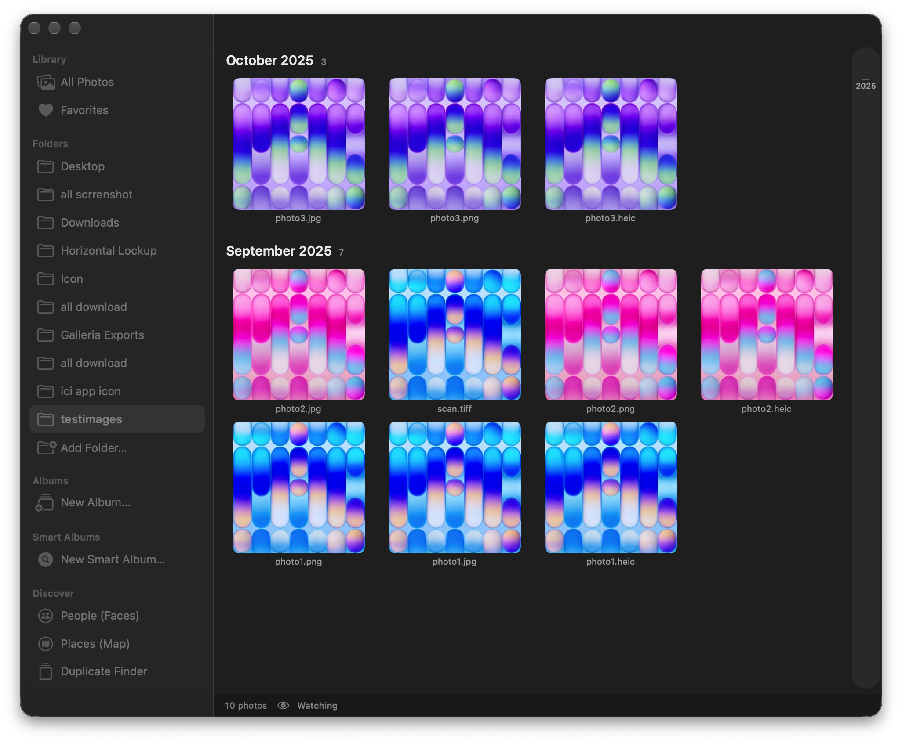
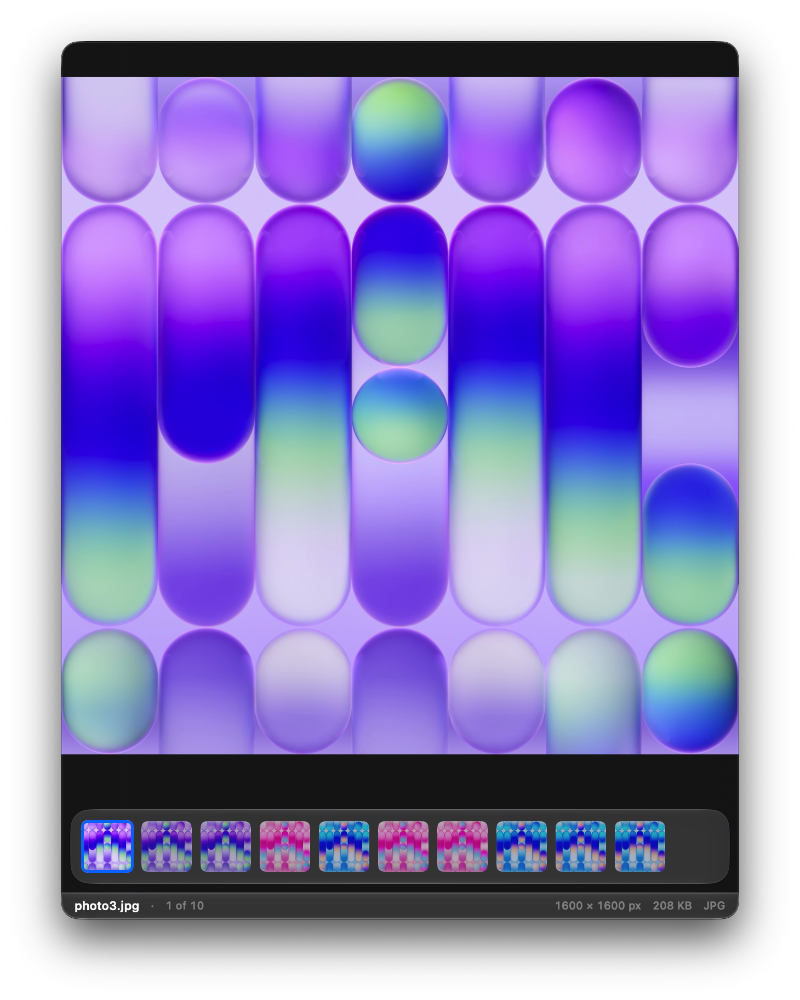
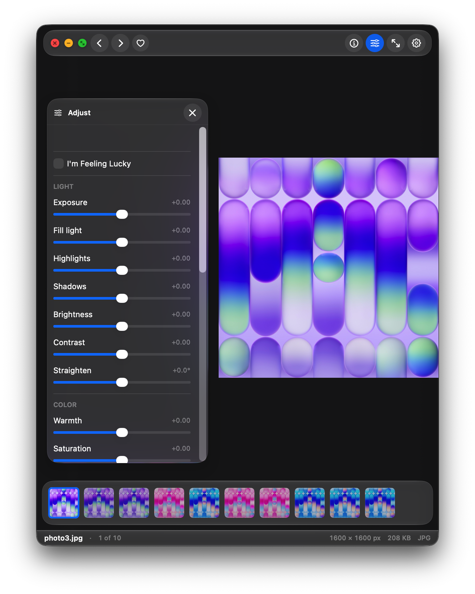
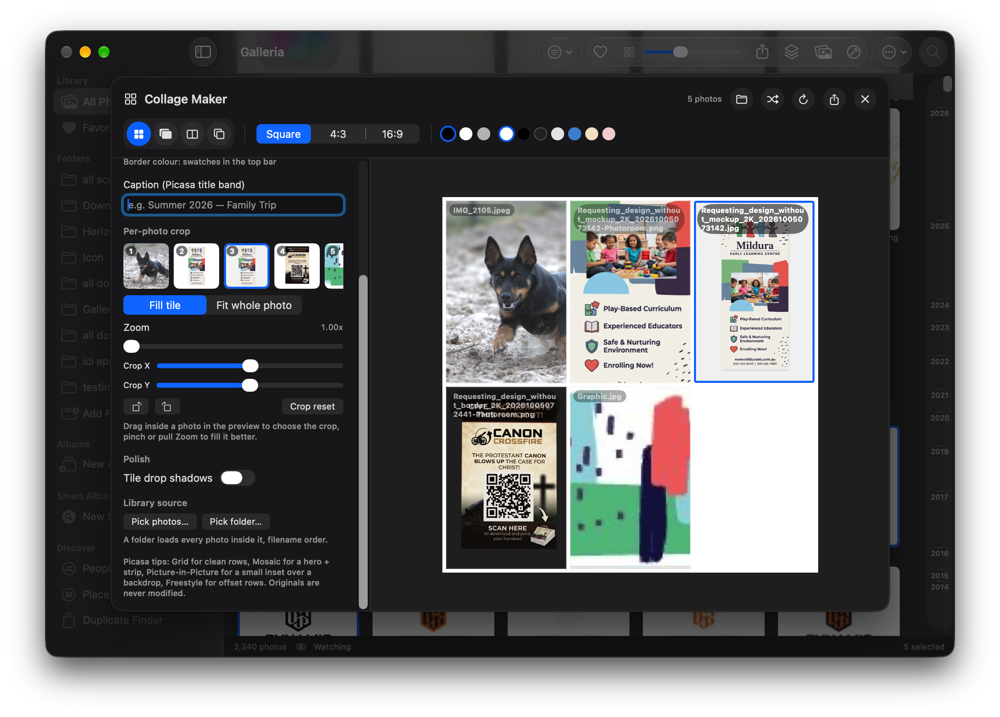

<p align="center">
  
</p>

<h1 align="center">Galleria</h1>

<p align="center">
  <strong>A Picasa-style, folder-based photo library for macOS.</strong><br/>
  Free · Offline · No account · No import step · Nothing ever copied, moved or renamed.
</p>

<p align="center">
  <a href="https://github.com/nileshsolanki38-lab/galleria/actions/workflows/build.yml">
    
  </a>
  
  
  
  
</p>

<p align="center">
  <a href="https://github.com/nileshsolanki38-lab/galleria/releases/latest">
    
  </a>
</p>

<p align="center">
  <a href="#-quick-start">Quick start</a> ·
  <a href="#-features">Features</a> ·
  <a href="#-screenshots">Screenshots</a> ·
  <a href="#-contributing">Contributing</a>
</p>

---

## ✨ Why Galleria?

- 📂 **Folder-based, not import-based** — point it at `~/Pictures` and it indexes what's already there.
- 🔒 **100 % offline & local** — no account, no cloud, no telemetry. Your photos never leave your Mac.
- 🖼 **Non-destructive** — edits are JSON recipes in SQLite; the original file is never touched.
- 🪶 **Lightweight** — Swift + SwiftUI + SQLite, zero third-party dependencies.
- 🆓 **Free & open source** (MIT).

---

## 📥 Download & install (no developer tools needed)

**For everyone** — no Xcode, no Terminal, no command line:

1. Go to the [**Releases page**](https://github.com/nileshsolanki38-lab/galleria/releases/latest).
2. Download **`Galleria.dmg`**.
3. Double-click the DMG to mount it.
4. Drag **Galleria.app** into the **Applications** folder.
5. Eject the DMG and launch Galleria from Applications (or Spotlight).

> macOS may warn about an unidentified developer the first time — right-click → **Open** → **Open** to bypass (the app is ad-hoc signed). This only happens once.

---

## 🚀 Quick start

```bash
# 1. Download the latest build
#    (or build from source — see below)

# 2. Open it
open /Applications/Galleria.app

# 3. Add a folder
#    ⇧⌘O  →  pick ~/Pictures (or any folder)
```

### Build from source (no Xcode needed)

```bash
git clone https://github.com/nileshsolanki38-lab/galleria.git
cd galleria
./Scripts/build.sh          # compiles against the macOS 26 SDK
open dist/Galleria.app
```

---

## 🎯 Features

### 📚 Library
- 🗂 Folder-based indexing with FSEvents watching — new photos appear within seconds.
- 🔍 Search by filename, tags, captions; rating filter; thumbnail size slider.
- ⭐ Favorites, 0–5★ ratings, albums, smart albums.
- 🧭 Timeline scrubber grouped by month/year (uses EXIF capture date).
- ⌨️ Full keyboard navigation (← → ↑ ↓, Return, Esc, Space, ⌘E, …).

### 🖼 Viewer
- 🪟 Compact photo-shaped glass window; Full Screen is an action (F or the green button) — no mode setting, no second menu flash.
- 🔎 Pointer-anchored zoom, pan, slideshow, info panel (EXIF/GPS).
- 🎞 Window-anchored filmstrip (off by default): scroll through photos to reveal it briefly, hover a thumbnail for Dock-style magnification.
- ✏️ Non-destructive edits: Exposure, Fill light, Highlights, Shadows, Brightness, Contrast, Straighten, Warmth, Saturation, Sharpen, Vignette, 8 filters, crop, rotate, flip, markup, resize, instant alpha, red-eye assist.
- 📋 Copy/paste adjustments between photos.

### 🎨 Collage maker
- Grid / Picture-in-Picture / Mosaic / Freestyle layouts.
- Spacing, corner radius, borders, caption band, shuffle, transparent background, Square/4:3/16:9 canvas.
- Pick a folder or hand-select photos; per-photo crop (fill tile / fit whole photo, zoom, pan drag, quarter turns).
- Tile drop shadows and hi-res export on a 4000 px canvas. Originals are never modified.

### 🧠 Pro tools
- 🔍 **Compare** 2–4 photos side by side.
- 👤 **People** — on-device Vision face detection, per-photo counts.
- 🗺 **Places** — MapKit pins from EXIF GPS.
- 📁 **Smart Albums** — saved searches.
- 👯 **Duplicate Finder** — perceptual hashing.
- 📦 **Batch** — resize / convert / rename in one pass.

### 🖥 Window chrome
- Native minimise / maximise / close, transparent glass panels.
- Finder-style status bar: filename · counter · dimensions · file size · type.
- Right-click — or the T/B/Tab/F shortcuts — to show or hide the top bar, filmstrip and other chrome; nothing floats over your photo.

---


## 📸 Screenshots

### Photo library (grid)


### Viewer with edits


### Adjustments panel


### Collage maker


---

## Install / run

```bash
# installed here:
open /Applications/Galleria.app

# rebuild from source (Command Line Tools only, no Xcode needed)
./Scripts/build.sh
```

`Scripts/build.sh` compiles against the macOS 26 SDK on purpose: the macOS 27 SDK turns SwiftUI's
`@State` into a macro whose plugin only ships with full Xcode, which isn't installed on this Mac.

---

## What works today (P0)

### Library
- **Folder-based indexing** — `Add Folder…` (⇧⌘O). Point at `~/Pictures`, `~/Desktop`, a card dump, anything.
  Recursive scan, skips hidden files and app bundles.
- **Folder watching** — FSEvents watches every library root, so photos you add, replace or delete in
  Finder appear/disappear within a couple of seconds. No manual rescan. The status bar shows `Watching`.
- **Incremental indexing** — a rescan only reads metadata for new or changed files and skips everything
  else entirely. Rows for deleted files are removed automatically. Also runs once at launch.
- **SQLite catalogue** at `~/Library/Application Support/Galleria/library.sqlite`.
- **Thumbnail cache** at `~/Library/Caches/Galleria/Thumbs` — 320 px JPEGs generated once, then instant.
  In-memory `NSCache` on top so scrolling back up is free.
- **Formats** — HEIC/HEIF, JPEG, PNG, TIFF, GIF, WebP, AVIF, BMP, SVG, JPEG XL, EXR/HDR, PSD, ICNS,
  and camera RAW (DNG, CR2, CR3, NEF, ARW, RAF, ORF, RW2, PEF, SRW). ImageIO does the decoding; SVG,
  PSD, ICNS and a few others fall back to AppKit's rasteriser. WebP can be read but not written.
- **Privacy-aware folder access** — if macOS hasn't granted access to a folder (Desktop, Downloads,
  iCloud Drive), Galleria refuses to add it rather than adding an empty entry, and tells you to check
  System Settings › Privacy & Security › Files and Folders. A permission error never deletes rows.
- **Sidebar** — All Photos, Favorites, every indexed folder, and albums. Right-click a folder to remove it from the
  library (files are left alone).
- **Search** — toolbar search field matches filename, tags and captions, case-insensitively.
- **Rating filter** — show 1★ and up.
- **Thumbnail size slider** — 56 → 320 px, like Picasa's zoom. Each thumbnail shows its **filename**
  underneath (hidden only at the very smallest sizes, where the text would be illegible).
- **Keyboard** — Return opens the selected photo, `←`/`→` move one photo, `↑`/`↓` move a whole row,
  and the grid scrolls to keep the selection visible. Arrow keys are ignored while you're typing in
  search. ⌘E exports, ⇧⌘O adds a folder, ⌘R rescans.
- **Context menu on any thumbnail** — Open, Show in Finder, Copy Filename, Add/Remove from Favorites,
  and a 0–5 star Rating menu.
- **Favorites** — click the heart in the viewer (or press `.`) to heart a photo. Hearts show on grid
  thumbnails, the toolbar Favorite button toggles the whole selection, and the **Favorites** smart
  album filters the library to just those photos. Favorites are stored in the catalogue and survive
  relaunches.
- **Open With** — in Finder, choose *Open With › Galleria* (or drag photos onto the app). Galleria adds
  the photo's folder to the library if needed, scans it, and opens that exact photo in the viewer. It
  stays a single window instead of spawning one per file.

### Timeline
- The grid is grouped by **month and year**, newest first, with sticky section headers.
- **Timeline scrubber** down the right edge, like Picasa: drag it to jump to any month. Year ticks are
  labelled; a pill shows the month you're passing through.
- Grouping uses the **EXIF capture date** (`DateTimeOriginal`, falling back to the file's modification
  date), so the timeline reflects when a photo was actually taken, not when it was copied.

### Viewer (double-click any photo, or select one and press Return)
- **Folder-scoped** — opening a photo browses only the photos in that photo's folder (its whole
  folder is scanned first). The filmstrip, arrow keys and scroll wheel never leave that folder, even
  when the grid is filtered by search, rating or Favorites. The counter reads e.g. “9 of 10”.
- **Two presentations, chosen in Viewer settings:**
  - **Full screen** (default) — opens with the controls hidden. The photo sits on a blurred, darkened
    copy of itself with a floating glass top bar and filmstrip over it. Press `Tab` (or `H`) to reveal
    the chrome.
  - **Compact window** — the window is sized to the photo itself: a square photo gets a square window,
    a portrait photo a portrait window, with **no blurred backdrop, letterboxing, padding or margins**.
    The photo is always shown at its own aspect ratio, so it can never be stretched or squeezed. Only
    three floating macOS-style corner buttons (close, info, full screen) are shown; `Tab` reveals a
    compact top bar and filmstrip, and `B` toggles the bar on its own.
- **Responsive compact top bar** — the bar measures the window and keeps only the controls that fit:
  close / filename / full screen / settings on a narrow photo, with previous-next, info, favorite and
  adjustments appearing as the photo gets wider.
- **Compact controls** — choose **Corner buttons** (hidden traffic lights, photo edge-to-edge) or
  **Title bar** (native traffic lights and a minimal title bar) in Viewer settings. The compact window
  is locked to the photo's shape, so it cannot be resized into a stretched or letterboxed view.
- Arrow keys `←` `→` move through the folder, `Esc` closes, `Space` toggles 2.5× zoom, `F` full screen.
- **Click outside the photo** collapses back to the grid; **double-click the photo** goes full screen.
- `Tab` / `H` hides or shows all chrome for a completely clean view. `T` toggles the filmstrip, `B` the
  top bar, `I` the info panel, `E` adjustments.
- `+` / `−` zoom in and out, `0` or `1` fit to window. The zoom button shows the current percentage.
- **Scroll over the photo zooms toward the pointer**, exactly like Google Photos: the point under
  the cursor stays put while the image grows or shrinks. Pinch and **⌘-scroll** also zoom.
- **Scroll over the filmstrip steps previous/next** (one gentle trackpad swipe or wheel notch = one
  photo), while a horizontal swipe still scrolls the strip itself. Scrolling over the info panel keeps
  its native behaviour.
- Drag to pan when zoomed in. Zoom never goes below "fit", so the photo can't shrink into a dot.
- **Filmstrip** at the bottom, auto-scrolls to keep the current photo centred. Its thumbnail size is
  adjustable from **Viewer settings** (48–140 pt, default 84) and the strip can be hidden entirely.
- **Viewer settings** (gear button) — filmstrip size slider, show/hide filmstrip, show/hide top bar,
  **Open viewer in** (Full screen / Compact window), **Compact controls** (Corner buttons / Title bar),
  “Start with controls hidden”, slideshow interval (2/3/5/10 s), and a shortcut to the full
  keyboard-shortcuts sheet. Switching presentation takes effect immediately.
- **Slideshow** (`S` or the play button) advances automatically, loops at the end, and pauses on a
  second press. The interval comes from Viewer settings.
- **Info panel** — dimensions, file size, camera, lens, ISO, shutter, aperture, focal length,
  date taken (shown as a readable date, not raw EXIF), GPS coordinates, path.
- **Star ratings** 1–5, click the same star again to clear. The heart beside the stars (or `.`)
  adds/removes the photo from Favorites.
- **Keyboard Shortcuts sheet** — press `?`, use Viewer settings › Keyboard Shortcuts…, or choose
  View › Keyboard Shortcuts… (⌘/) to see every navigation, zoom and view shortcut in one place.
- **Non-destructive edits** stored as a JSON recipe in SQLite — the original file is never modified:
  - **I'm Feeling Lucky** (Core Image auto-adjust: levels, contrast, colour)
  - Rotate left / right, flip horizontally
  - Crop with a drag rectangle
  - Reset all edits
- Everything re-renders live, and the recipe is applied again on export.
- A file that can't be decoded (truncated, empty, wrong extension) shows **"Can't display this file"**
  instead of hanging; the grid cell shows a warning icon instead of spinning forever.

### Albums & export
- **New Album** from the current selection (sidebar `New Album…` or toolbar Actions menu).
- **Export Selected…** (⌘E, or Actions menu) writes full-resolution copies with edits baked in to
  `~/Pictures/Galleria Exports`. The folder is created on first use and remembered after that.
- **Export Selected to Folder…** picks a different destination for this batch.
- Exports never overwrite: a second export of `photo1.png` becomes `photo1-1.png`.
- File extensions stay honest — PNG stays PNG, HEIC stays HEIC, TIFF stays TIFF, everything else is
  written as JPEG — so the file opens in the right app. Originals are untouched.
- Status bar always shows the library count; scan/export messages appear next to it and fade out.

---

## What’s new in 1.0 (Pro — Picasa-style)

### Professional editing (D4–D9 done)
- Adjustments panel now has **Light** (Exposure, Fill light, Highlights, Shadows, Brightness, Contrast, Straighten ±8°), **Color** (Warmth, Saturation), **Detail** (Sharpen, Vignette) and **Filters** (Mono, Sepia, Vintage, Vivid, Fade, Silver, Warm) — all non-destructive JSON recipes, live re-render, baked in on export.
- Material: same transparent frosted panel as Picasa’s floating toolbar — `.glassSurface` (Liquid Glass on macOS 26+, `.ultraThinMaterial` before), so the panel and window controls share one theme.

### Preview-style editing (compact)
- Adjustments is now a **compact 248pt panel** like Preview’s (small Light/Color/Detail sections), not the wide Picasa panel.
- **Markup (Preview Toolbar):** Adjust → *Markup (Preview)*. Drag on the photo to add Rectangle / Oval / Line / Arrow / Text / Freehand with colour + stroke. Baked into export; Undo / Clear; stored non-destructively in the recipe.
- **Resize (Preview Tools → Adjust Size):** Adjust → *Resize…* — width/height with proportional lock, live preview, export resized JPEG copy.
- **Instant Alpha:** Adjust → *Alpha* — Vision foreground mask removes the background to a transparent PNG (checkerboard preview), export PNG.
- **Copy/Paste style:** Adjust → *Copy style / Paste* — copy the full adjustment recipe to another photo.

### Collage maker (F1 done — Picasa-style)
- **Collage Maker** (`⇧⌘C`, toolbar `square.stack.3d.up`, thumbnail right-click → *Make Collage…*, viewer → *Make Collage…*): **Grid / Picture-in-Picture / Mosaic / Freestyle**, spacing 0–32 pt, corner radius, **Borders** (width + Black/White/Grey), **Caption** title band, PIP size/X/Y, **Shuffle**, Square / 4:3 / 16:9 canvas, background (White, Black, **None (transparent)**, Grey, Blue, Warm, Rose). Live preview; export to `~/Pictures/Galleria Exports/Collages` as JPEG.

### Filmstrip anchoring + collapse (viewer polish)
- The filmstrip is pinned to the **window bottom** (not the photo): changing photos of different aspect ratios no longer moves it, so mouse scroll stays over the same pixels — over the strip it steps photos, over the photo it zooms. The compact window is **bottom-anchored** for the same reason; the photo fills the full area above the strip.
- Clicking empty space now **collapses** in two stages: fullscreen → photo-sized compact window → grid. No more jumping straight to the grid.

### Pro tools (B5/C4/C5/C6/C8/D10/E1 done)
- **Compare (B5):** toolbar `Compare` or right-click → side-by-side 2–4 photos with ratings/dimensions.
- **People (C4):** sidebar Discover → People. On-device Vision face rectangles (no upload), per-photo counts, sample scan.
- **Places (C5):** sidebar Discover → Places. MapKit pins for EXIF-GPS photos + list; empty state when no GPS.
- **Smart Albums (C6):** sidebar Smart Albums → saved searches (name + search + min rating + favorites). Choose in sidebar to filter the grid.
- **Duplicate Finder (C8):** sidebar Discover → duplicates. Perceptual SHA-256 of a tiny render groups copies; Reveal in Finder to delete manually (Galleria never deletes for you).
- **Red-eye assist (D10):** viewer Adjustments → Red-eye assist. Detects eyes via Vision landmarks; applies gentle eye-friendly colour (true inpainting out of scope).
- **Batch (E1):** toolbar `Batch` or right-click → max dimension (keep / 1024 / 2048 / 4096), JPEG/PNG/HEIC, rename pattern `{name} {date} {index}`.

### Window chrome — native + transparent, always easy to get back
- Compact viewer **defaults to the native title bar** so minimise / maximise (zoom) / close are the real macOS traffic lights that follow light/dark theme (Viewer settings → *Compact controls: Title bar*). Corner-glass buttons remain available.
- When all chrome is hidden, a small floating **“Show controls · Tab”** pill stays on screen — click it or press `Tab`/`H` to bring everything back. Right-click anywhere also opens the full *Show All Controls* menu, so you can never get stuck.
- Filmstrip, top bar, info and adjustments each toggle independently (`T` / `B` / `I` / `E`) with their own reveal pill (`Filmstrip`).

### Default viewer
- qView uninstalled (moved to Trash). **Galleria is now the system default** for JPEG / PNG / GIF / BMP / SVG / WebP / AVIF / RAW / `public.image` (`LSHandlerRank: Default` + LaunchServices set). Preview remains available via *Open With* if you prefer it.
- **Apple-protected types:** macOS marks HEIC and TIFF as Apple-default (`LSIsAppleDefaultForType`) and protects their double-click handler, so those still open in Preview by default. To make Galleria the default for HEIC/TIFF: right-click any `.heic`/`.tiff` file → **Get Info** → *Open with: Galleria* → **Change All…**. This is a one-time, per-type setting stored in your LaunchServices database; Galleria cannot override it programmatically.

### Still not built
| Feature | Status |
|---|---|
| Slideshow (F2) | done — auto-advance, loop, pause, interval |
| All above B5/C4/C5/C6/C8/D10/E1/F1 | done (top — Picasa Pro set) |
| Automated blemish inpainting | not started — Red-eye assist + lighting cover most cases |

---

## Layout

```
Sources/Galleria/
  App.swift           entry point, single-window scene, menus, --scan CLI hook
  Models.swift        Photo, Album, EditRecipe, PhotoFilter, CollageRecipe, SidebarItem
  LibraryStore.swift  SQLite catalogue: folders, incremental scan, albums, smart albums, face counts, ratings, tags, edits
  FolderWatcher.swift FSEvents-based folder watching
  Imaging.swift       ThumbnailService, EXIF/capture-date reader, Core Image editor + exporter + CollageEngine
  ContentView.swift   sidebar, timeline grid, scrubber, toolbar, PhotoCell, Open With handling
  ViewerView.swift    viewer, pointer-anchored zoom, window-anchored filmstrip/top bar, settings, slideshow, info/edit panels,
                      crop overlay, shortcuts sheet, key + scroll monitors, always-visible “Show controls” pill, two-stage collapse
  CollageView.swift   Picasa-style collage maker (Grid/PIP/Mosaic/Freestyle, borders, caption, shuffle, live preview, export)
  FeaturesView.swift  Compare, Faces (Vision), Places (MapKit + EXIF GPS), Smart Albums, Duplicate Finder, Batch tools, GeoHelper
  PreviewTools.swift  Preview-style: ResizeSheet, Instant Alpha (Vision foreground mask), ResizeHelper, MarkupColors helpers
Resources/Info.plist  bundle id com.nileshsolanki.galleria, document types
Resources/AppIcon.icns app icon (built from AppIcon-1024.png)
Resources/AppIcon-1024.png  master icon: full-bleed pinwheel artwork, no background border
Scripts/build.sh      compile + bundle + ad-hoc sign
dist/Galleria.app     build output
```

## Notes

- The app is ad-hoc signed (no Developer ID). Gatekeeper assessments are disabled on this Mac,
  so it launches normally. If you ever move it to another Mac you'll need to right-click → Open once.
- **Rebuilding changes the app's code identity**, so macOS may ask again for folder access after each
  build. That's a macOS rule for unsigned apps, not a Galleria bug.
- Library database and thumbnails are plain files — deleting `~/Library/Caches/Galleria` just
  forces thumbnails to regenerate. **Clear Thumbnail Cache** in the Actions menu does the same in-app.
- `Galleria --scan <folder>` on launch indexes a folder headlessly, handy for scripting.
- The app was previously called PhotoCraft; its database and thumbnail cache were migrated to the
  `Galleria` folders, so nothing was re-indexed from scratch.
- **Default image app** — Galleria (`com.nileshsolanki.galleria`) is the system handler for image files since 1.0.1 (qView removed, Preview available via *Open With*).

## QA summary

## QA summary

Tested on a generated 1,085-file corpus (JPEG, PNG, HEIC up to 4032×3024, TIFF, GIF, BMP, plus
corrupt/empty/mislabelled files): 1,084 images indexed in under a second, ~90 thumbnails/s on a cold
cache, only ~13 grid cells realised at rest. Verified folder watching (add/delete), search, rating
filter, albums, timeline scrubber, keyboard navigation, zoom, crop/rotate/auto-enhance, HEIC rendering,
export collisions and format correctness, and graceful handling of undecodable files. No crashes.

Recent pass: all **10/10** files in `testimages/` (JPEG, PNG, HEIC at 1200–6016 px, plus TIFF) were
opened individually through Finder **Open With** and the viewer showed the exact requested file each
time — both on a cold launch and while the app was already running. Opening a photo from a folder
that was not yet in the library added and scanned it, then showed that exact photo too. Grid `←`/`→`/`↑`/`↓` moved the
selection by 1/1/row/row and Return opened it. The Google Photos scroll model was verified: scrolling
over the photo zoomed toward the pointer (414 → 452 px), scrolling down over the filmstrip advanced
one photo and scrolling up went back. Viewer settings persisted across viewer close/reopen and a full
app relaunch (filmstrip 116 pt), the filmstrip hid/shows with `T` and the reveal pill, slideshow paused
with `S` and looped from the last photo to the first, and the shortcuts sheet opened with `?`.
Favorites were toggled with `.`, appeared with a heart badge in the grid, filtered correctly in the
Favorites smart album, and survived a relaunch. The viewer opens **full screen with the chrome hidden**
(photo only) and `Tab`/`H` reveals the controls; opening `testimages/photo2.heic` from a grid filtered
to a single Favorites result still showed “7 of 10”, and the filmstrip/scroll scope stayed inside
`testimages`. The bundled `AppIcon.icns` is present and 1024 px;
every pixel inside its rounded tile is opaque with no flat background border. Viewer chrome, filmstrip
and filename captions were checked via the accessibility tree.

---

## 🤝 Contributing

Contributions are welcome! See [CONTRIBUTING.md](CONTRIBUTING.md) for build instructions and guidelines.

- 🐛 Found a bug? [Open an issue](https://github.com/nileshsolanki38-lab/galleria/issues).
- 💡 Have an idea? [Start a discussion](https://github.com/nileshsolanki38-lab/galleria/discussions).
- ⭐ If you like Galleria, **star the repo** — it helps others discover it.

## 📜 License

[MIT](LICENSE) © 2026 Nilesh Solanki. Free to use, modify and distribute.

## 🙏 Acknowledgements

- Built with Swift + SwiftUI, Core Image, Vision, MapKit, SQLite.
- Inspired by Google Picasa and macOS Preview.
